<div align="center">


# metabox

**Веб-панель для sing-box на роутерах с OpenWrt**

Правка конфига в формах, применение с автоматическим откатом, объяснение, куда ушло каждое соединение.

[](./LICENSE)


[English](./README.md) · **Русский**

</div>

---

metabox — демон на Go (`metaboxd`), который ставится на роутер пакетом apk и раздаёт встроенный веб-интерфейс. Панель работает с конфигом [sing-box-extended](https://github.com/shtorm-7/sing-box-extended) — форка sing-box: формы для узлов, правил маршрутизации и наборов правил (rule-set), ручная правка JSON и проверка значений по схеме форка до того, как конфиг попадёт на роутер.

Применение (Apply) проверяет конфиг бинарём sing-box, перезапускает службу, ждёт ответа Clash API и DNS и возвращает предыдущую версию, если проверка не прошла или вы не подтвердили в панели за минуту, что связь жива.

В пакете есть своя служба sing-box и перехват трафика LAN (nftables, tproxy, upstream для dnsmasq), поэтому metabox может работать вместо re:HomeProxy.

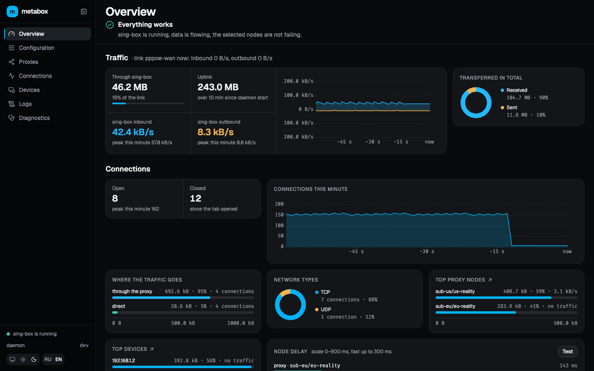

## Возможности

- Правила маршрутизации: поиск, добавление, удаление, перестановка; форма правила для действия, наборов правил и ходовых условий или узел целиком в JSON
- Наборы правил: подключение remote и local, видно, какие правила ссылаются на каждый набор
- Каждая секция конфига в форме, собранной по схеме форка; незнакомые поля сохраняются как есть и помечаются в интерфейсе
- Весь конфиг текстом и построчный дифф перед применением
- Применение с проверками и автооткатом, история версий с восстановлением
- Соединения: живой список с фильтрами, выгрузка в CSV и JSON, объяснение, какое правило направило соединение
- Прокси: группы узлов с замером задержки, обновление подписок
- Устройства из аренд DHCP, переключатель «через sing-box» для каждого
- Обзор: трафик, соединения, топ устройств и узлов, загрузка, температура и память роутера
- Лог sing-box и диагностика перехвата
- MCP-эндпоинт для ИИ-агентов вроде Claude Code: они читают состояние роутера через типизированные инструменты, только чтение, по отдельному токену
- Светлая и тёмная тема, русский и английский, раскладка для компьютера и телефона

## Скриншоты

<details>
<summary><b>Компьютер</b></summary>

|                                 Правила                                  |                                    Прокси                                    |
| :----------------------------------------------------------------------: | :--------------------------------------------------------------------------: |
| 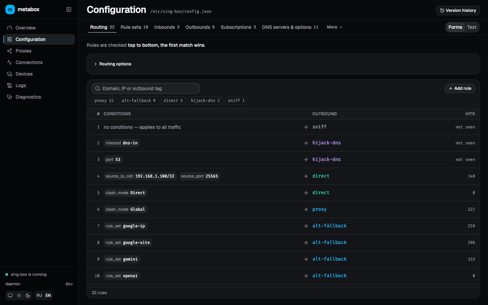 | 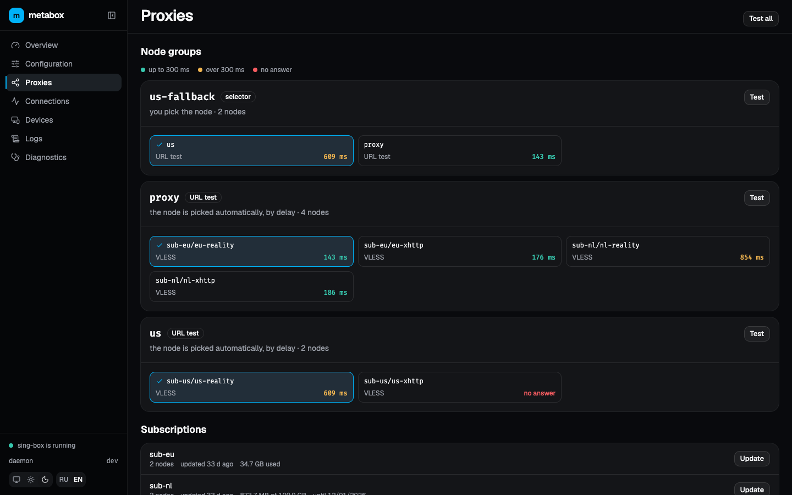 |

|                                      Соединения                                      |                                  Устройства                                  |
| :----------------------------------------------------------------------------------: | :--------------------------------------------------------------------------: |
| 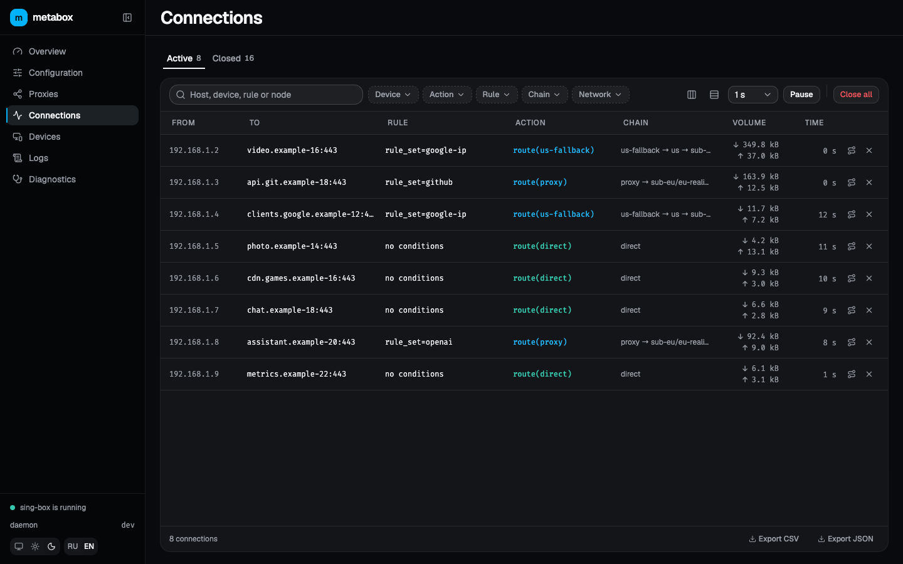 | 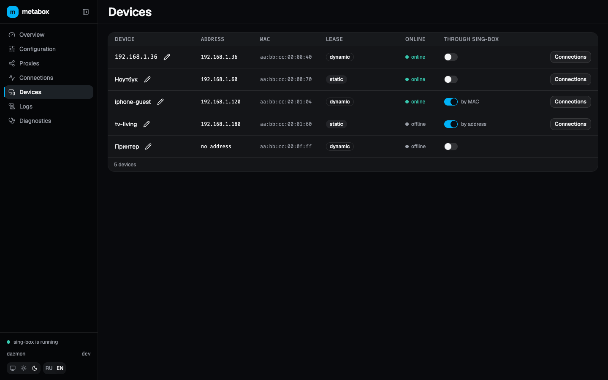 |

</details>

<details>
<summary><b>Телефон</b></summary>

|                                     Обзор                                     |                                 Правила                                 |                                     Соединения                                      |
| :---------------------------------------------------------------------------: | :---------------------------------------------------------------------: | :---------------------------------------------------------------------------------: |
| 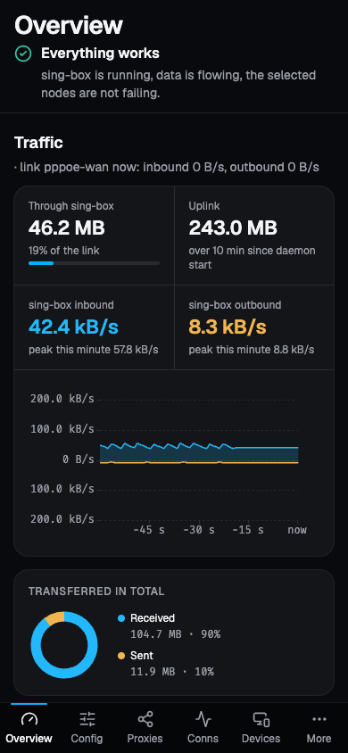 | 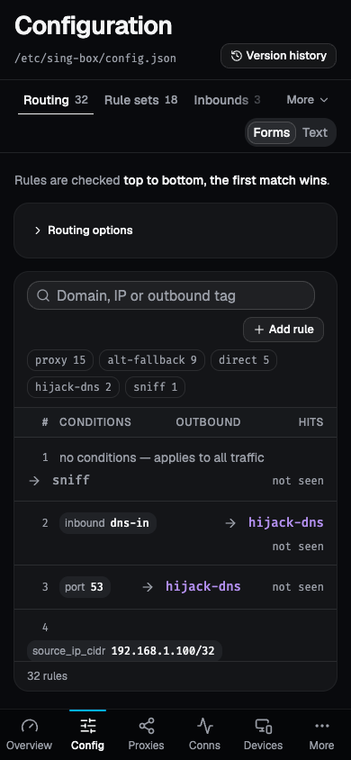 | 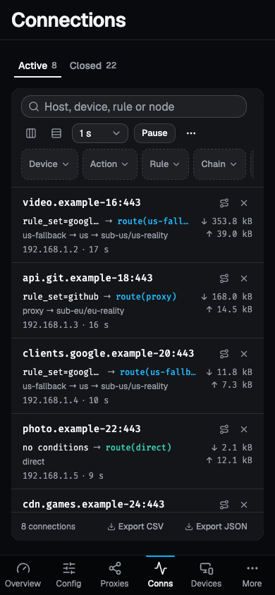 |

|                                   Прокси                                    |                                 Устройства                                  |                                 Логи                                  |
| :-------------------------------------------------------------------------: | :-------------------------------------------------------------------------: | :-------------------------------------------------------------------: |
| 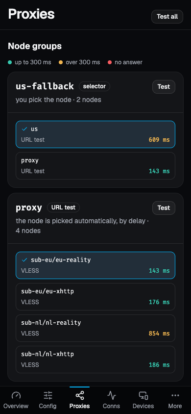 | 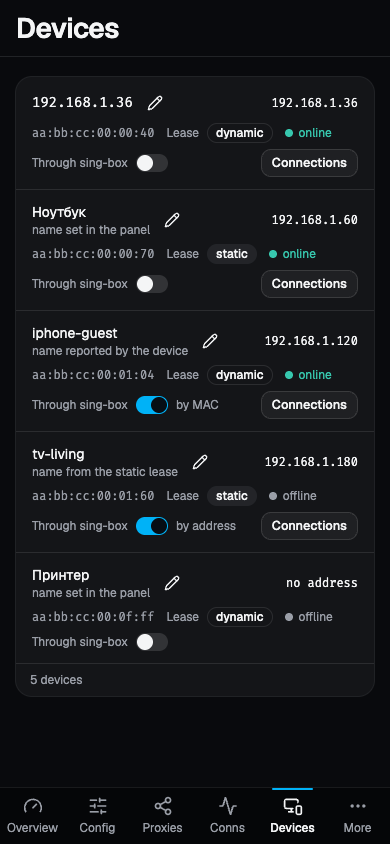 | 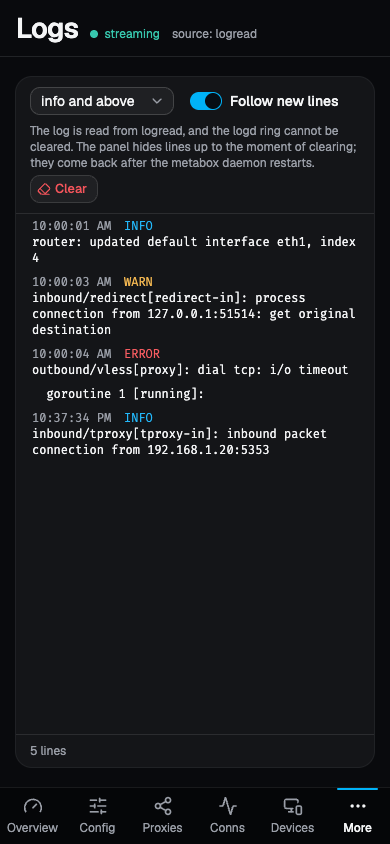 |

</details>

## Требования

- OpenWrt с пакетным менеджером apk: 25.12 или SNAPSHOT. Ветки 24.10 и старше используют opkg и не поддерживаются.
- aarch64, проверено на Banana Pi BPI-R4 Pro. Архитектура пакета должна совпадать с `/etc/apk/arch` на роутере; у прошивок mediatek/filogic это `aarch64_cortex-a53`.
- Пакет `sing-box-extended`, `metaboxd` объявляет его зависимостью. Проверенная версия — `1.14.1-extended-2.7.2`, пакеты для OpenWrt лежат в [релизах форка](https://github.com/shtorm-7/sing-box-extended/releases).

| Порт             | Кто слушает                                                                           |
| ---------------- | ------------------------------------------------------------------------------------- |
| 8088             | панель по http, на адресах сетей из `listen_interface`; по HTTPS с `option https '1'` |
| 9090             | Clash API sing-box на `127.0.0.1`, если секцию `clash_api` добавил демон              |
| 5331, 5332, 5333 | входы sing-box для перехвата: TCP через redirect, UDP через tproxy, DNS               |

## Установка

Релизы выкладываются подписанным репозиторием apk. На роутере, от root:

```sh
wget -qO- https://mderkach.github.io/metabox/install.sh | sh
```

Скрипт ([`install.sh`](./install.sh)) проверяет, что на роутере OpenWrt с apk и архитектура `aarch64_cortex-a53`, кладёт ключ проекта и строку репозитория, ставит `sing-box-extended` из [релиза форка](https://github.com/shtorm-7/sing-box-extended/releases), если его нет, со сверкой пакета по sha256, записанному в скрипте, и выполняет `apk add metaboxd`. До первой версии без суффикса пре-релиза пакеты лежат в канале `testing`; `sh -s -- --channel stable` подключает `stable`. Скрипт спрашивает язык текстов, которые демон показывает оператору (справка, сообщения init-скриптов, детали ответов API, MCP), и пишет его в UCI `metabox.main.lang`; `--lang en|ru` отвечает заранее. Язык панели выбирается в самой панели. Обновление — `apk update && apk upgrade metaboxd`. Сборка пакета из исходников и установка отдельного файла — в [`docs/Development.ru.md`](./docs/Development.ru.md).

Руками то же самое: ключ, репозиторий, затем пакет. `sing-box-extended` должен стоять заранее: в репозитории его нет.

```sh
wget -O /etc/apk/keys/metabox-release.pem https://raw.githubusercontent.com/mderkach/metabox/main/keys/metabox-release.pem
echo https://mderkach.github.io/metabox/apk/testing/packages.adb > /etc/apk/repositories.d/metabox.list
apk update
apk add metaboxd
```

`sing-box-extended` приносит свою службу `sing-box`. Скрипт выключает её, когда сам ставит форк; после ручной установки выключите её сами: sing-box поднимает служба metabox.

```sh
/etc/init.d/sing-box stop
/etc/init.d/sing-box disable
```

Если сейчас sing-box поднимает homeproxy, оставьте его как есть: перехват metabox по умолчанию выключен и с ним не конфликтует.

Положите конфиг sing-box в `/etc/sing-box/config.json` и запустите службы — при установке пакета они сами не стартуют.

```sh
/etc/init.d/metabox-singbox enable
/etc/init.d/metabox-singbox start
/etc/init.d/metaboxd enable
/etc/init.d/metaboxd start
```

## Первый запуск

Откройте `http://<адрес роутера в LAN>:8088`, например `http://192.168.1.1:8088`. Адрес нужен IP, а не имя: демон отвечает, только если в заголовке `Host` стоит IP-адрес или `localhost`, поэтому `http://openwrt.lan:8088` не откроется.

Панель работает по обычному http, как LuCI: пароль, сессия и токен MCP идут по LAN открытым текстом. `option https '1'` в `/etc/config/metabox` и перезапуск `metaboxd` включают HTTPS с сертификатом от корня, который выпускает демон, а http на том же порту перенаправляется. Браузер тогда предупреждает, пока этот корень не установлен на каждом устройстве: скачайте его по адресу `http://192.168.1.1:8088/metabox-ca.crt`, сверьте отпечаток со строкой `ca_sha256` в `logread -e metaboxd` и добавьте в хранилище доверенных сертификатов системы или браузера; на телефоне откройте адрес и установите профиль. Корень ограничен приватными сетями и адресами панели: подписать сертификат для публичного сайта им нельзя. Сертификат, который на роутере уже есть, например выпущенный `acme.sh` для LuCI, отдаётся вместо собственного: укажите в той же секции `https_cert` и `https_key` с путями к PEM-файлам и перезапустите `metaboxd`; после продления перезапустите ещё раз.

> [!WARNING]
> Без пароля панель открыта любому устройству в сетях из `listen_interface`, и любое из них может поменять маршрутизацию. Пароль задаётся кнопкой **Задать пароль** внизу боковой панели. Забытый пароль сбрасывается по SSH: `rm /etc/metabox/auth.json && /etc/init.d/metaboxd restart`.

Демон читает `/etc/sing-box/config.json` как есть, отдельного импорта нет. Рукописный конфиг открывается в формах, а то, чего формы не знают, сохраняется без изменений и помечается в интерфейсе. Если в конфиге нет `experimental.clash_api`, демон добавит её при первом применении (`127.0.0.1:9090`, случайный секрет): через неё панель читает соединения и прокси.

| Что                        | Где                                                                                          |
| -------------------------- | -------------------------------------------------------------------------------------------- |
| Настройки панели           | `/etc/config/metabox`                                                                        |
| Конфиг sing-box            | `/etc/sing-box/config.json`, задаётся `config_dir` и `config_name`                           |
| Версии конфига и состояние | `/etc/metabox/`                                                                              |
| Сертификаты                | `/etc/metabox/tls/`; удалите каталог и перезапустите `metaboxd`, чтобы получить новый корень |
| Логи                       | `logread` или экран «Логи»                                                                   |

### Перехват трафика LAN

По умолчанию перехват выключен: `option enabled '0'` в секции `dataplane` файла `/etc/config/metabox`. Если стоит homeproxy, сначала остановите его, иначе две системы будут заворачивать один и тот же трафик.

В конфиге sing-box должны быть входы на портах из секции `dataplane`: `direct` на 5333 для DNS, `redirect` на 5331, `tproxy` на 5332 для UDP, а `route.default_mark` должен быть равен `self_mark` (100).

> [!WARNING]
> Без входа на 5333 у всей сети пропадёт DNS: dnsmasq отправляет запросы туда.

```sh
uci set metabox.dataplane.enabled='1'
uci commit metabox
/etc/init.d/metabox-singbox restart
```

В режиме `acl_mode 'listed'` (по умолчанию) через sing-box идут только устройства, которым проход включён на экране «Устройства» или которые перечислены в `source_ip` и `source_mac`. В режиме `all` — все устройства с `br-lan`.

### ИИ-агенты через MCP

Демон отдаёт [MCP](https://modelcontextprotocol.io)-эндпоинт по адресу `/mcp`, по умолчанию он выключен. Включается кнопкой **Доступ MCP** внизу боковой панели: панель один раз показывает токен и готовую команду для Claude Code:

```sh
claude mcp add --transport http metabox http://192.168.1.1:8088/mcp --header "Authorization: Bearer <токен>"
```

С включённым HTTPS в команде стоит `https://`, и клиент должен доверять сертификату панели. Claude Code отвергает собственный корень демона с ошибкой `unsupported name constraint type`; своя пара сертификата через `https_cert` и `https_key` этой проблемы не имеет.

После этого агента можно спросить, почему сайт идёт по такому-то правилу, какие соединения у устройства, какие узлы отвечают, что было в прошлых версиях конфига, что пишет лог sing-box и диагностика перехвата. Ещё агент может узнать про любое поле конфига: его тип, допустимые значения и у каких типов узлов оно есть, по той же схеме форка, что и панель. Доступ только на чтение: инструментов, которые меняют конфиг или службу, нет. Секреты во фрагментах конфига скрыты, хвост лога sing-box отдаётся как есть.

Токен не зависит от пароля панели и не открывает панель. Новый токен отключает старый, кнопка **Выключить** в том же окне выключает MCP. По SSH: `rm /etc/metabox/mcp.json && /etc/init.d/metaboxd restart`.

## Обновление и удаление

Новый пакет ставится так же, как первый, после чего службы перезапускаются:

```sh
/etc/init.d/metabox-singbox restart
/etc/init.d/metaboxd restart
```

Пакет, установленный из файла (`apk add /tmp/metaboxd-<версия>.apk`), записывается в `/etc/apk/world` с привязкой к хешу, `metaboxd><Q1…`. `apk upgrade metaboxd` такую запись не обновляет, а `apk add -u metaboxd` тянет вместе с ней обновления системных зависимостей. Чтобы вернуться на репозиторий, выполните `apk add metaboxd=<версия>`, а затем `apk add metaboxd`: запись станет обычным именем, и `apk upgrade metaboxd` снова работает.

Ваш `/etc/config/metabox` при обновлении не затирается: версия из пакета ложится рядом как `/etc/config/metabox.apk-new`. sysupgrade сохраняет `/etc/config/metabox` и `/etc/metabox/`.

```sh
/etc/init.d/metaboxd stop
/etc/init.d/metaboxd disable
/etc/init.d/metabox-singbox stop
/etc/init.d/metabox-singbox disable
apk del metaboxd
```

`stop` службы `metabox-singbox` снимает перехват: правила nftables, `ip rule` и фрагмент dnsmasq. После удаления sing-box не запущен — если он нужен, включите службу форка или homeproxy.

## Документация

- [`docs/PRD.md`](./docs/PRD.md) — требования, критерии приёмки, этапы
- [`docs/adr/`](./docs/adr/README.md) — архитектурные решения
- [`apps/metaboxd/docs/guides/`](./apps/metaboxd/docs/guides/README.md) — гайды демона: HTTP API, работа с устройством, ошибки и логи
- [`apps/web/docs/`](./apps/web/docs/README.md) — гайды фронтенда
- [`docs/Development.ru.md`](./docs/Development.ru.md) — сборка, стенд, команды
- [`CONTRIBUTING.ru.md`](./CONTRIBUTING.ru.md) — ветки, коммиты, проверки
