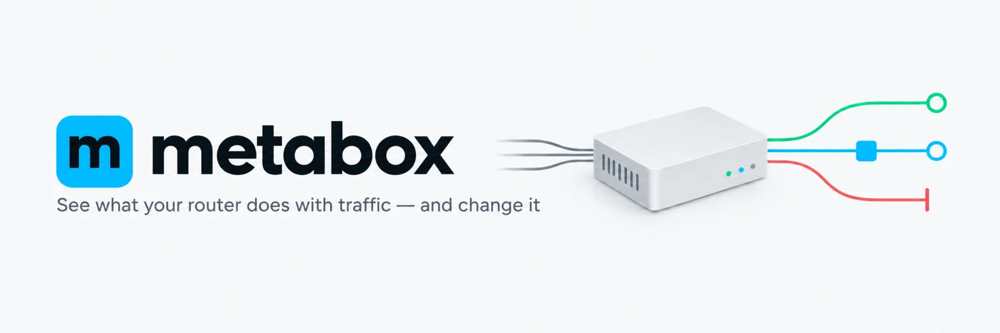

<div align="center">

<picture>
  <source media="(prefers-color-scheme: dark)" srcset="docs/readme/banner-dark.webp" />
  
</picture>

**Смотрите, что роутер делает с трафиком, и меняйте это**

Правка конфига в формах, применение с автоматическим откатом, объяснение, куда ушло каждое соединение.

[](./LICENSE)


[English](./README.md) · **Русский**

</div>

---

metabox — веб-панель для sing-box на роутере с OpenWrt. Она для владельцев роутеров, которые пускают трафик через sing-box и хотят управлять им в браузере, а не править JSON руками по SSH.

Конфиг, написанный руками, легко сломать: одно неверное поле — и роутер без интернета, пока не исправите из терминала. metabox показывает конфиг формами и проверяет каждое значение до сохранения. Применение (Apply) перезапускает sing-box, проверяет, что он работает, и возвращает предыдущую версию, если проверка не прошла. Откат случится и тогда, когда вы за минуту не подтвердили в панели, что связь жива.

metabox ставится на роутер одним пакетом apk. В нём демон `metaboxd` со встроенной панелью, служба, которая запускает sing-box, и перехват трафика LAN, включаемый по желанию.

**Статус:** пре-релиз. Проверено только на Banana Pi BPI-R4 Pro (aarch64).


## Возможности

- Правила маршрутизации: поиск, добавление, удаление, перестановка; форма для каждого правила или правило целиком в JSON
- Наборы правил (rule-set): подключение remote и local, видно, какие правила ссылаются на каждый набор
- Каждая секция конфига — форма, собранная по схеме sing-box-extended; незнакомые поля сохраняются и помечаются
- Весь конфиг текстом и построчный дифф перед применением
- Применение с проверками и автооткатом, история версий с восстановлением
- Соединения: живой список с фильтрами, выгрузка в CSV и JSON, какое правило направило каждое соединение
- Прокси: группы узлов с замером задержки, обновление подписок
- Устройства из аренд DHCP, переключатель «через sing-box» для каждого
- Обзор: трафик, соединения, топ устройств и узлов, загрузка, температура и память роутера
- Лог sing-box и диагностика перехвата
- MCP-эндпоинт только на чтение для ИИ-агентов вроде Claude Code
- Светлая и тёмная тема, русский и английский, раскладка для компьютера и телефона

## Скриншоты

<details>
<summary><b>Компьютер</b></summary>

|                                 Правила                                  |                                    Прокси                                    |
| :----------------------------------------------------------------------: | :--------------------------------------------------------------------------: |
|  |  |

|                                      Соединения                                      |                                  Устройства                                  |
| :----------------------------------------------------------------------------------: | :--------------------------------------------------------------------------: |
|  |  |

</details>

<details>
<summary><b>Телефон</b></summary>

|                                     Обзор                                     |                                 Правила                                 |                                     Соединения                                      |
| :---------------------------------------------------------------------------: | :---------------------------------------------------------------------: | :---------------------------------------------------------------------------------: |
|  |  |  |

|                                   Прокси                                    |                                 Устройства                                  |                                 Логи                                  |
| :-------------------------------------------------------------------------: | :-------------------------------------------------------------------------: | :-------------------------------------------------------------------: |
|  |  |  |

</details>

## Требования

- OpenWrt 25.12 или SNAPSHOT. В этих версиях пакетный менеджер apk. OpenWrt 24.10 и старше используют opkg и не поддерживаются.
- Роутер на aarch64. Пакеты собираются под `aarch64_cortex-a53` — архитектуру прошивок mediatek/filogic. Свою можно узнать командой `cat /etc/apk/arch`.
- Пакет `sing-box-extended`. `metaboxd` от него зависит, скрипт установки ставит его сам. Проверенная версия — `1.14.1-extended-2.7.2`.

## Установка

1. На роутере от root запустите скрипт установки:

   ```sh
   wget -qO- https://mderkach.github.io/metabox/install.sh | sh
   ```

2. Положите свой конфиг sing-box в `/etc/sing-box/config.json` (см. [ниже](#где-взять-конфиг-sing-box)) и запустите службы. При установке пакета они сами не стартуют.

   ```sh
   /etc/init.d/metabox-singbox enable
   /etc/init.d/metabox-singbox start
   /etc/init.d/metaboxd enable
   /etc/init.d/metaboxd start
   ```

3. Откройте `http://<IP роутера>:8088`, например `http://192.168.1.1:8088`, и задайте пароль кнопкой **Задать пароль** внизу боковой панели. Нужен именно IP, а не имя вроде `openwrt.lan`: панель отвечает только на запросы по IP — это защита от DNS rebinding (атаки, при которой чужой домен направляют на адрес роутера).

> [!WARNING]
> Без пароля панель открыта любому устройству в локальных сетях роутера, и любое из них может поменять маршрутизацию. Забытый пароль сбрасывается по SSH: `rm /etc/metabox/auth.json && /etc/init.d/metaboxd restart`.

Скрипт установки ([`install.sh`](./install.sh)) делает вот что:

- спрашивает язык сообщений демона: справка, сообщения служб, ошибки API, MCP. `--lang en|ru` отвечает заранее. Язык панели выбирается в самой панели;
- проверяет, что на роутере OpenWrt с apk и архитектура `aarch64_cortex-a53`;
- добавляет ключ подписи проекта и репозиторий пакетов;
- ставит `sing-box-extended`, если его нет, и сверяет его sha256 со значением в скрипте;
- выполняет `apk add metaboxd` и сохраняет язык в UCI `metabox.main.lang`.

Пока стабильного релиза нет, пакеты лежат в канале `testing`. Канал `stable` подключается флагом скрипта: `wget -qO- https://mderkach.github.io/metabox/install.sh | sh -s -- --channel stable`.

## Где взять конфиг sing-box

metabox не создаёт конфиг, и в пакете его нет. Нужен свой: от провайдера прокси или написанный руками. Без `/etc/sing-box/config.json` служба `metabox-singbox` не стартует, а панель сообщает, что конфига на устройстве нет.

Демон читает файл как есть, отдельного импорта нет. То, чего формы не знают, сохраняется без изменений и помечается в панели. Если в конфиге нет секции `experimental.clash_api`, демон добавит её при первом применении (`127.0.0.1:9090`, случайный секрет). Через неё панель читает соединения и прокси.

## Подробнее

<details>
<summary><b>Установка вручную</b></summary>

`sing-box-extended` нет в репозитории metabox. Поставьте его заранее: пакеты для OpenWrt лежат на [странице его релизов](https://github.com/shtorm-7/sing-box-extended/releases).

Затем добавьте ключ и репозиторий и поставьте пакет:

```sh
wget -O /etc/apk/keys/metabox-release.pem https://raw.githubusercontent.com/mderkach/metabox/main/keys/metabox-release.pem
echo https://mderkach.github.io/metabox/apk/testing/packages.adb > /etc/apk/repositories.d/metabox.list
apk update
apk add metaboxd
```

Индекс репозитория подписан тем же ключом. В канале `testing` все релизы. В канале `stable` только релизы без суффикса пре-релиза, поэтому он пуст до первого такого релиза.

У пакета `sing-box-extended` есть своя служба `sing-box`. metabox запускает sing-box через `metabox-singbox`, поэтому служба `sing-box` должна быть выключена. Скрипт установки выключает её сам; после ручной установки сделайте это сами:

```sh
/etc/init.d/sing-box stop
/etc/init.d/sing-box disable
```

Дальше — с шага 2 установки.

Сборка пакета из исходников: [`docs/Development.ru.md`](./docs/Development.ru.md#пакет-для-роутера).

</details>

<details>
<summary><b>HTTPS</b></summary>

По умолчанию панель работает по обычному http, как LuCI. Пароль, сессия и токен MCP идут по LAN без шифрования.

Чтобы перейти на HTTPS, задайте `option https '1'` в `/etc/config/metabox` и перезапустите `metaboxd`. Демон создаст свой корневой сертификат и выпустит от него сертификат панели. http на том же порту перенаправляется на HTTPS. Корень подписывает сертификаты только для приватных сетей и адресов панели, не для публичных сайтов.

Браузер предупреждает, пока корень не установлен на каждом устройстве:

1. Скачайте его по адресу `http://192.168.1.1:8088/metabox-ca.crt`.
2. Сверьте отпечаток со строкой `ca_sha256` в `logread -e metaboxd`.
3. Добавьте его в доверенные сертификаты системы или браузера. На телефоне откройте адрес и установите профиль.

Если на роутере уже есть сертификат, например от `acme.sh` для LuCI, панель может использовать его. Укажите в той же секции `https_cert` и `https_key` с путями к PEM-файлам и перезапустите `metaboxd`. После каждого продления перезапустите снова.

</details>

> [!WARNING]
> Если включаете перехват трафика LAN, в конфиге sing-box должен быть вход (inbound) для DNS на порту 5333. Без него у всей сети пропадёт DNS: dnsmasq отправляет запросы туда.

<details>
<summary><b>Перехват трафика LAN</b></summary>

Перехват пускает трафик устройств LAN через sing-box без настройки каждого устройства. Он использует правила nftables, tproxy для UDP и sing-box как вышестоящий DNS-сервер для dnsmasq.

По умолчанию перехват выключен: `option enabled '0'` в секции `dataplane` файла `/etc/config/metabox`. Если трафик LAN уже перехватывает другая служба, сначала остановите её. Иначе обе будут захватывать один и тот же трафик.

В конфиге sing-box нужны входы на портах из секции `dataplane`:

- `direct` на 5333 для DNS;
- `redirect` на 5331 для TCP;
- `tproxy` на 5332 для UDP;
- и `route.default_mark`, равный `self_mark` (100).

Включение:

```sh
uci set metabox.dataplane.enabled='1'
uci commit metabox
/etc/init.d/metabox-singbox restart
```

С `acl_mode 'listed'` (по умолчанию) через sing-box идут только некоторые устройства: включённые на экране «Устройства» или перечисленные в `source_ip` и `source_mac`. С `acl_mode 'all'` — все устройства с `br-lan`.

</details>

<details>
<summary><b>ИИ-агенты через MCP</b></summary>

[MCP](https://modelcontextprotocol.io) (Model Context Protocol) позволяет ИИ-агенту вызывать инструменты на роутере. Демон отдаёт его по адресу `/mcp`; по умолчанию он выключен.

Включается кнопкой **Доступ MCP** внизу боковой панели. Панель один раз показывает токен и готовую команду для Claude Code:

```sh
claude mcp add --transport http metabox http://192.168.1.1:8088/mcp --header "Authorization: Bearer <токен>"
```

После этого агент отвечает на такие вопросы:

- почему сайт идёт по такому-то правилу;
- какие соединения у устройства;
- какие узлы отвечают;
- что было в прошлых версиях конфига;
- что пишут лог sing-box и диагностика перехвата;
- что значит поле конфига: его тип, допустимые значения и у каких типов узлов оно есть.

Доступ только на чтение: ни один инструмент не меняет конфиг или службы. Секреты во фрагментах конфига скрыты. Лог sing-box отдаётся как есть.

Токен не связан с паролем панели и не открывает панель. Новый токен заменяет старый. Кнопка **Выключить** в том же окне выключает MCP. По SSH: `rm /etc/metabox/mcp.json && /etc/init.d/metaboxd restart`.

С включённым HTTPS в команде стоит `https://`, и клиент должен доверять сертификату панели. Claude Code отвергает собственный корень демона с ошибкой `unsupported name constraint type`. Свой сертификат через `https_cert` и `https_key` этой проблемы не имеет.

</details>

<details>
<summary><b>Обновление и удаление</b></summary>

Обновление:

```sh
apk update && apk upgrade metaboxd
```

Пакет перезапускает демон, если тот был запущен. sing-box продолжает работать, поэтому обновление не прерывает трафик. Новая версия службы sing-box начинает действовать после `/etc/init.d/metabox-singbox restart`; запустите его, когда короткий перерыв трафика допустим.

Пакет, поставленный из файла (`apk add /tmp/metaboxd-<версия>.apk`), закрепляется за этим файлом в `/etc/apk/world` записью `metaboxd><Q1…`. `apk upgrade metaboxd` такой пакет не обновляет, а `apk add -u metaboxd` тянет заодно обновления системы. Чтобы вернуться на репозиторий:

```sh
apk add metaboxd=<версия>
apk add metaboxd
```

Обновление не затирает ваш `/etc/config/metabox`: новая версия по умолчанию ложится рядом как `/etc/config/metabox.apk-new`. sysupgrade сохраняет `/etc/config/metabox` и `/etc/metabox/`.

Удаление:

```sh
/etc/init.d/metaboxd stop
/etc/init.d/metaboxd disable
/etc/init.d/metabox-singbox stop
/etc/init.d/metabox-singbox disable
apk del metaboxd
```

Остановка `metabox-singbox` снимает перехват: правила nftables, `ip rule` и настройки dnsmasq. После удаления sing-box не запущен, и трафик LAN идёт напрямую. Пакет `sing-box-extended` остаётся; если он не нужен, удалите его командой `apk del sing-box-extended`.

</details>

<details>
<summary><b>Где лежат файлы</b></summary>

| Что                        | Где                                                                                          |
| -------------------------- | -------------------------------------------------------------------------------------------- |
| Настройки панели           | `/etc/config/metabox`                                                                        |
| Конфиг sing-box            | `/etc/sing-box/config.json`; задаётся `config_dir` и `config_name`                           |
| Версии конфига и состояние | `/etc/metabox/`                                                                              |
| Сертификаты                | `/etc/metabox/tls/`; удалите каталог и перезапустите `metaboxd`, чтобы получить новый корень |
| Логи                       | `logread` или экран «Логи»                                                                   |

</details>

<details>
<summary><b>Порты</b></summary>

| Порт             | Кто слушает                                                              |
| ---------------- | ------------------------------------------------------------------------ |
| 8088             | панель, на адресах сетей из `listen_interface` (по умолчанию `lan`)      |
| 9090             | Clash API sing-box на `127.0.0.1`, если секцию `clash_api` добавил демон |
| 5331, 5332, 5333 | входы sing-box для перехвата: TCP через redirect, UDP через tproxy, DNS  |

</details>

## Документация

- [`docs/PRD.md`](./docs/PRD.md) — требования и этапы
- [`docs/adr/`](./docs/adr/README.md) — архитектурные решения
- [`docs/Development.ru.md`](./docs/Development.ru.md) — сборка из исходников, стенд, команды
- [`CONTRIBUTING.ru.md`](./CONTRIBUTING.ru.md) — как прислать изменение
- [`apps/metaboxd/docs/guides/`](./apps/metaboxd/docs/guides/README.md) — гайды демона
- [`apps/web/docs/`](./apps/web/docs/README.md) — гайды фронтенда
