<div align="center">

<picture>
  <source media="(prefers-color-scheme: dark)" srcset="docs/readme/banner-dark.webp" />
  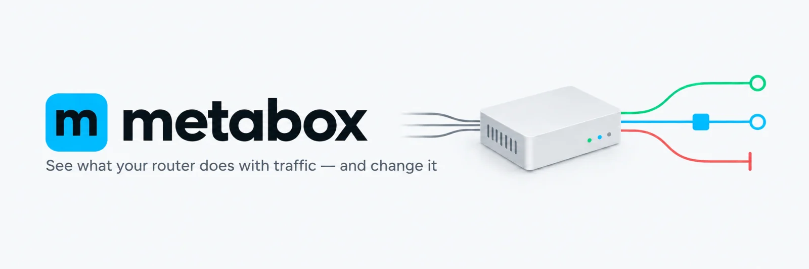
</picture>

**Смотрите, что роутер делает с трафиком, и меняйте это**

Правка конфига в формах, применение с автоматическим откатом, объяснение, куда ушло каждое соединение.

[](./LICENSE)


[English](./README.md) · **Русский**

</div>

---

metabox — веб-панель для управления трафиком на роутере. Она для владельцев роутеров, которые пускают трафик через ядро маршрутизации и хотят управлять им в браузере, а не править JSON руками по SSH.

Сейчас metabox работает с OpenWrt и ядром маршрутизации sing-box-extended.

Конфиг, написанный руками, легко сломать: одно неверное поле — и роутер без интернета, пока не исправите из терминала. metabox показывает конфиг формами и проверяет каждое значение до сохранения. Применение перезапускает ядро, проверяет его работу и возвращает предыдущую версию, если проверка не прошла. Откат случится и тогда, когда вы за минуту не подтвердили в панели, что связь жива.

metabox ставится на роутер одним пакетом apk. В нём демон `metaboxd` со встроенной панелью, служба, которая запускает sing-box, и перехват трафика LAN, включаемый по желанию.

**Статус:** пре-релиз. Проверено только на Banana Pi BPI-R4 Pro (aarch64).

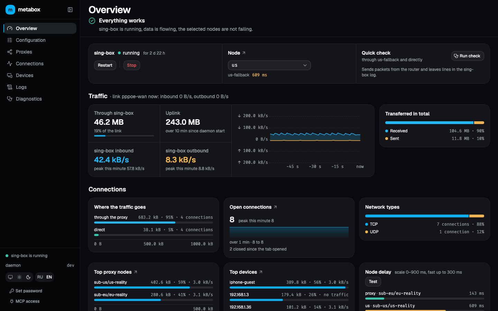

## Возможности

- Правила маршрутизации: поиск, добавление, удаление, перестановка; форма для каждого правила или правило целиком в JSON
- Сеты правил (rule-set): откройте строку, чтобы увидеть источник и правила, которые используют сет. Для удалённых сетов также показаны время последней проверки адреса ядром и размер сохранённой копии.
- Каждая секция конфига — форма, собранная по схеме sing-box-extended; незнакомые поля сохраняются и помечаются
- Весь конфиг текстом и построчный дифф перед применением
- Применение с проверками и автооткатом, история версий с восстановлением
- Соединения: живой список с фильтрами, выгрузка в CSV и JSON, какое правило направило каждое соединение
- Прокси: группы прокси с замером задержки, обновление подписок
- Импорт сервера VLESS по ссылке. Форма показывает пропущенные параметры перед добавлением сервера в черновик.
- Устройства из аренд DHCP, переключатель маршрутизации через ядро для каждого
- «Как работает metabox» показывает путь одного соединения и объясняет термины панели. На компьютере раздел открывается из «Справки» внизу боковой панели, на телефоне — из «Ещё».
- Обзор: состояние ядра и управление им, переключение выхода, быстрая проверка, трафик, соединения, топ устройств и серверов, загрузка, температура и память роутера
- Лог ядра и диагностика перехвата трафика с указанием сбоя в правиле маршрутизации, локальном маршруте или пересылке DNS
- MCP-эндпоинт только на чтение для ИИ-агентов вроде Claude Code
- Светлая и тёмная тема, русский и английский, раскладка для компьютера и телефона

### Настроить маршрут для сервиса в пустой конфигурации

Откройте **Маршруты** → **Простой** с пустым конфигом, доступным для редактирования.

1. В блоке **Начало настройки** нажмите **Сервер или подписка** и вставьте ссылку на сервер или HTTPS-адрес подписки. Для сервера проверьте распознанные настройки и список пропущенных параметров. Для подписки проверьте имя, группу и интервал обновления. Нажмите **Добавить в черновик**. Роутер загрузит новую подписку при нажатии **Применить**.
2. Если в черновике есть только импортированное подключение, настройте поддерживаемый путь для трафика и DNS на вкладке **Редактор**. Один из вариантов использует вход SOCKS или mixed для трафика с доменным именем назначения и отдельный вход типа `direct`, к которому первое правило маршрутизации применяет действие `hijack-dns`. Для прямого маршрута сервиса используйте обычный прямой выход и DNS-резолвер по TCP с IPv4-адресом и без прокси. Первый резолвер задайте в разделе **DNS-серверы и параметры**.
3. Вернитесь на вкладку **Простой** и выберите подсказку в разделе **Правила** или нажмите **Сервис**. Выберите сервис и его источник в каталоге, затем укажите подходящий выход в поле **Куда направлять** и проверьте поле **Резолвер DNS**. Если вы импортировали подписку, для пары правил выберите отдельный поддерживаемый выход, например прямое соединение или совместимый SOCKS5-сервер. Если для сервиса ещё нет подходящего назначения DNS, выберите резолвер. Проверьте позиции обоих правил в блоке **Изменения в черновике**, затем нажмите **Добавить в черновик**, чтобы сохранить пару целиком.
4. Чтобы отдельно назначить DNS доменам на поддерживаемом пути, откройте **Настройки DNS** → **Назначение DNS**. Выберите подходящий резолвер для прямых соединений, соединений через прокси или конкретного выхода. Назначение действует на домены, перечисленные для этого пути. Чтобы пополнить список резолверов, нажмите **Добавить сервер**. При добавлении сервера действующие назначения сохраняются.
5. Если на роутере уже работает поддерживаемый автоматический перехват, откройте **Настройки перехвата**. Укажите **Выбранных устройств** и нажмите **Выбрать устройства** либо явно выберите **Всех устройств**. Кнопка **Проверить изменение охвата** покажет текущий и предлагаемый охват. Нажмите **Применить перехват**, затем **Связь есть, оставить**, пока идёт отсчёт. Если время истечёт, роутер вернёт прежний охват. Эта операция применяется отдельно и сохраняет общий черновик конфигурации.
6. Переключайтесь между вкладками **Простой**, **Редактор** и **JSON**, чтобы просмотреть один и тот же черновик. Первое нажатие **Применить** открывает окно **Что уйдёт на устройство**. Проверьте **Изменения правил маршрутизации** и **Изменения записей и параметров**, затем раскройте **Текст изменений**, чтобы увидеть построчный дифф. Нажмите **Применить** в окне, чтобы запустить проверки и применить конфиг.

Если ядро отклонит конфиг, панель покажет ошибку и сохранит черновик для исправления. После успешного перезапуска и проверки работы ядра нажмите **Связь есть, оставить** в течение минуты. Если время на подтверждение истечёт, роутер восстановит прежний конфиг, а панель сохранит ваши правки в черновике. Чтобы вручную восстановить сохранённую версию, нажмите **История версий** и выберите **Вернуть** рядом с нужной версией. Восстановление проходит те же проверки и требует подтверждения.

### Задать обычную задержку сервера

В разделе **Прокси** нажмите на значение нормы или на карандаш рядом с ним, чтобы задать обычную задержку сервера в миллисекундах. Enter или галочка сохраняют значение. Кнопка **Вернуть авто** снимает ручную настройку и возвращает вычисляемую норму, если есть замеры. Изменения сохраняются сразу, применять конфигурацию не нужно.

### Проверить существующий сервер REALITY

Если сервер VLESS REALITY перестал отвечать после обновления, запустите ручную проверку задержки в разделе **Прокси**. Откройте диагностику рядом с сервером. Если панель предлагает включить гибридный обмен ключами, добавьте настройку в черновик, примените и подтвердите изменения, затем повторите проверку того же сервера. Если сервер снова не ответил, можно вернуть прежнее значение через черновик. Проверьте, есть ли новая ссылка на сервер, или обновите соответствующую подписку. Неудачная проверка сама по себе не определяет причину.

## Скриншоты

<details>
<summary><b>Компьютер</b></summary>

|                                 Правила                                  |                                    Прокси                                    |
| :----------------------------------------------------------------------: | :--------------------------------------------------------------------------: |
| 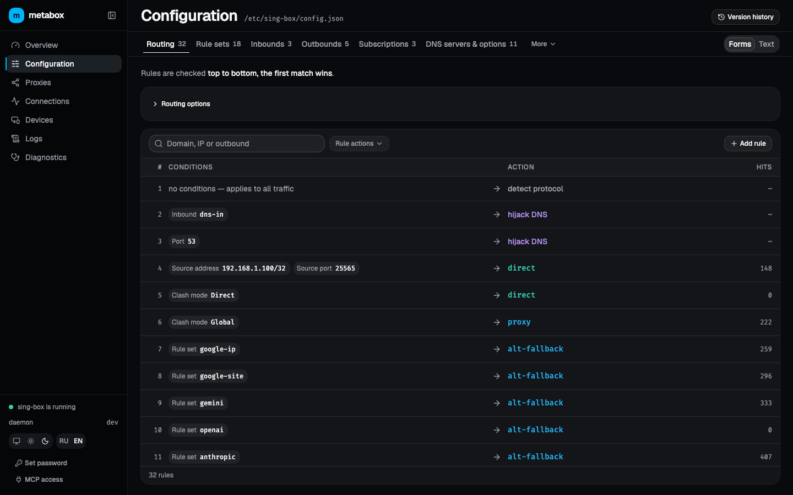 | 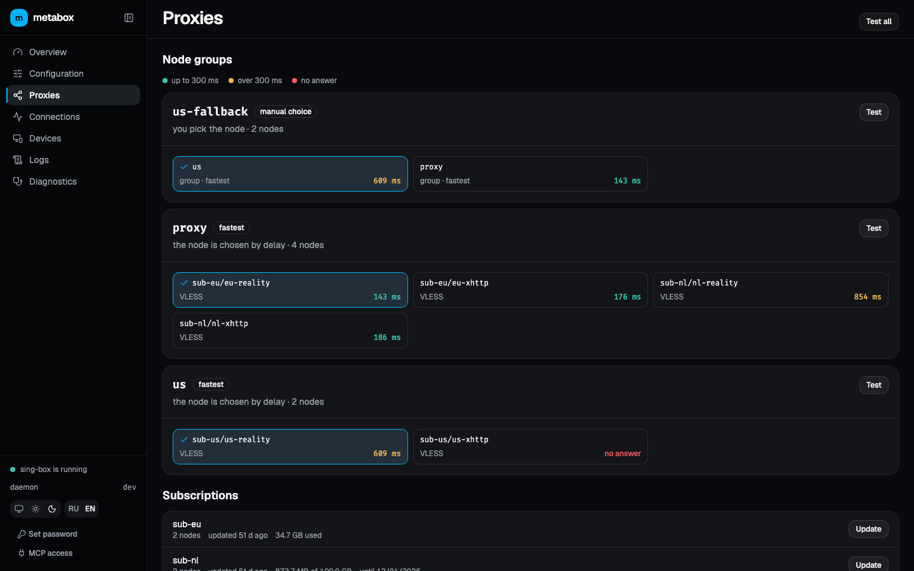 |

|                                      Соединения                                      |                                  Устройства                                  |
| :----------------------------------------------------------------------------------: | :--------------------------------------------------------------------------: |
| 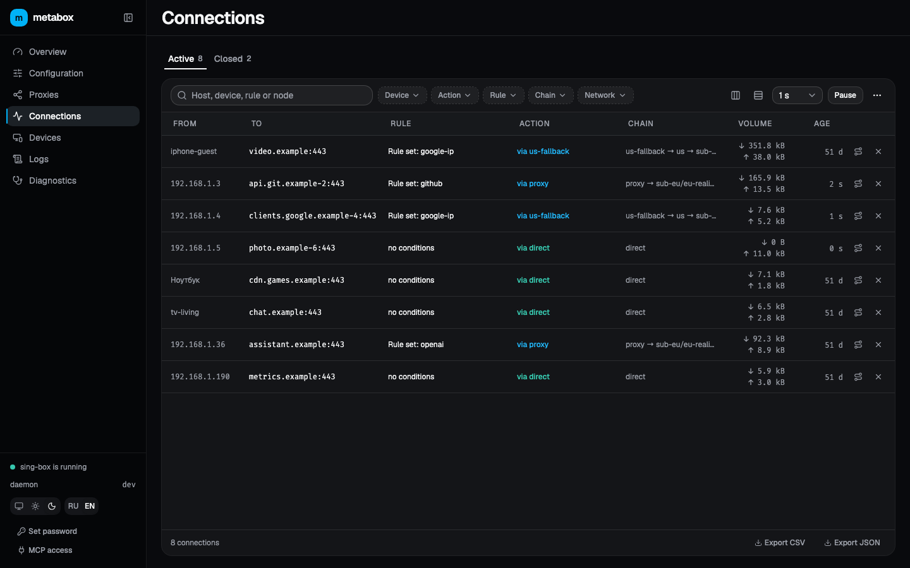 | 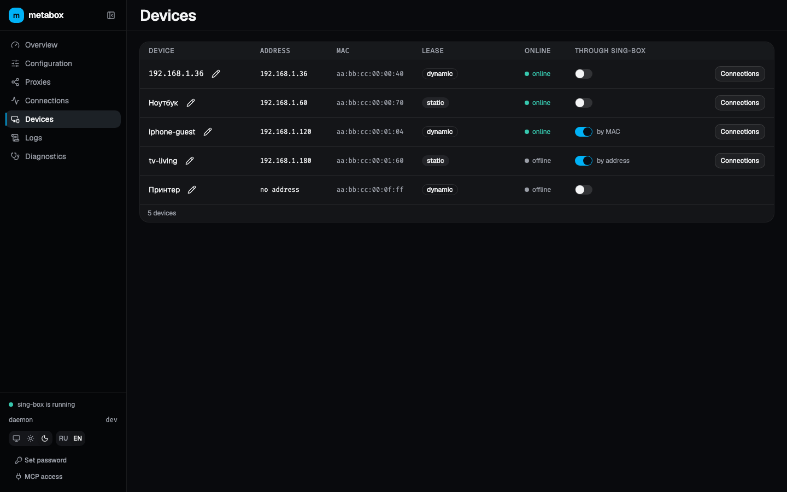 |

</details>

<details>
<summary><b>Телефон</b></summary>

|                                     Обзор                                     |                                 Правила                                 |                                     Соединения                                      |
| :---------------------------------------------------------------------------: | :---------------------------------------------------------------------: | :---------------------------------------------------------------------------------: |
| 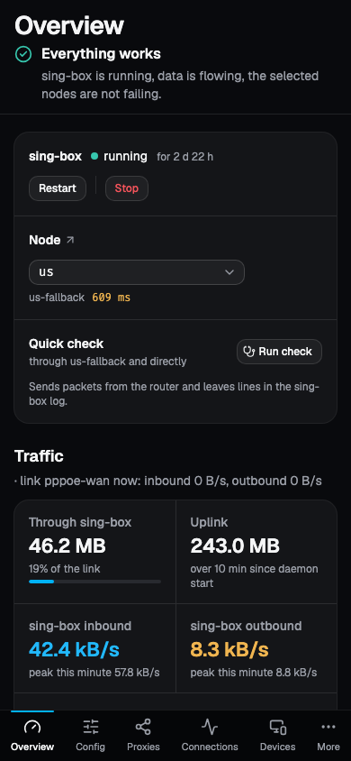 | 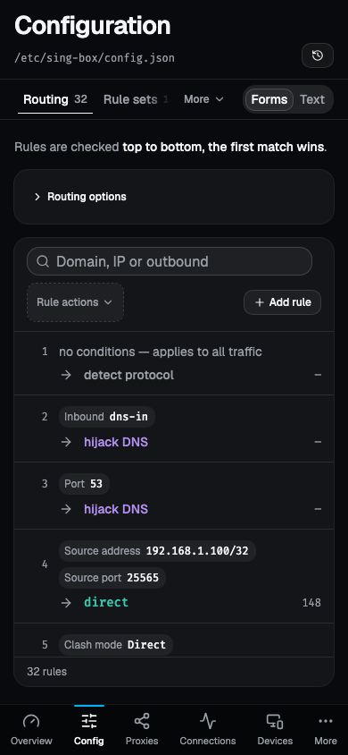 | 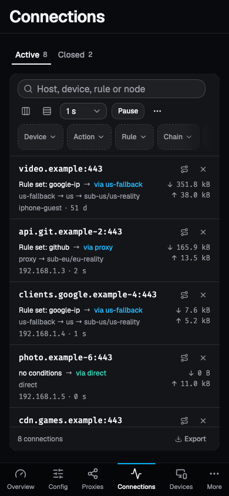 |

|                                   Прокси                                    |                                 Устройства                                  |                                 Логи                                  |
| :-------------------------------------------------------------------------: | :-------------------------------------------------------------------------: | :-------------------------------------------------------------------: |
| 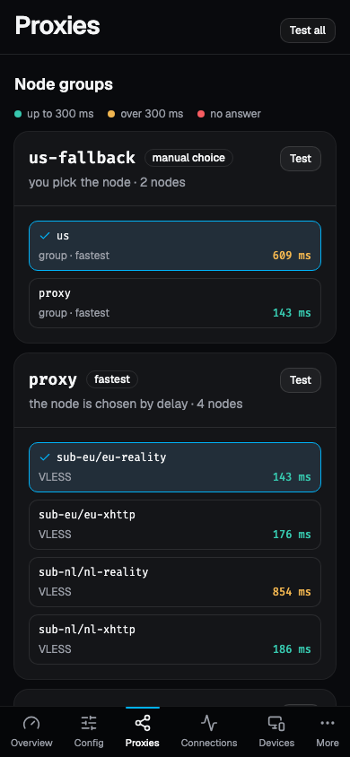 | 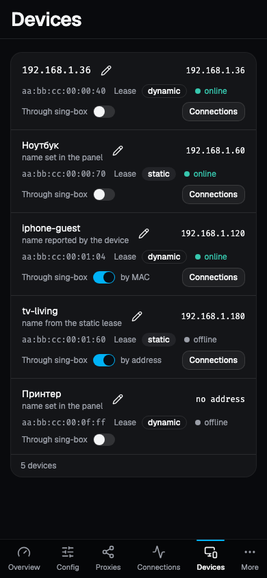 | 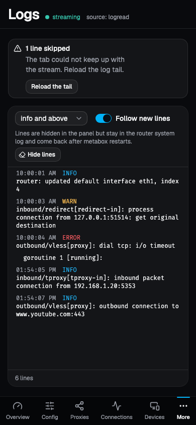 |

</details>

## Требования

- OpenWrt 25.12 или SNAPSHOT. В этих версиях пакетный менеджер apk. OpenWrt 24.10 и старше используют opkg и не поддерживаются.
- Роутер на aarch64. Пакеты собираются под `aarch64_cortex-a53` — архитектуру прошивок mediatek/filogic. Свою можно узнать командой `cat /etc/apk/arch`.
- Пакет `sing-box-extended`. `metaboxd` от него зависит, скрипт установки ставит его сам. Проверенная версия — `1.14.3-extended-2.7.3`.

## Установка

1. На роутере от root запустите скрипт установки:

   ```sh
   wget -qO- https://mderkach.github.io/metabox/install.sh | sh
   ```

2. Положите свой конфиг sing-box в `/etc/sing-box/config.json` (см. [ниже](#где-взять-конфиг-sing-box)) и запустите службы. При установке пакета они сами не стартуют.

   ```sh
   /etc/init.d/metabox-singbox enable
   /etc/init.d/metabox-singbox start
   /etc/init.d/metaboxd enable
   /etc/init.d/metaboxd start
   ```

3. Откройте `http://<IP роутера>:8088`, например `http://192.168.1.1:8088`, и задайте пароль кнопкой **Задать пароль** внизу боковой панели. Нужен именно IP, а не имя вроде `openwrt.lan`: панель отвечает только на запросы по IP — это защита от DNS rebinding (атаки, при которой чужой домен направляют на адрес роутера).

> [!WARNING]
> Без пароля панель открыта любому устройству в локальных сетях роутера, и любое из них может поменять маршрутизацию. Забытый пароль сбрасывается по SSH: `rm /etc/metabox/auth.json && /etc/init.d/metaboxd restart`.

Скрипт установки ([`install.sh`](./install.sh)) делает вот что:

- спрашивает язык сообщений демона: справка, сообщения служб, ошибки API, MCP. `--lang en|ru` отвечает заранее. Язык панели выбирается в самой панели;
- проверяет, что на роутере OpenWrt с apk и архитектура `aarch64_cortex-a53`;
- добавляет ключ подписи проекта и репозиторий пакетов;
- ставит `sing-box-extended`, если его нет, и сверяет его sha256 со значением в скрипте;
- выполняет `apk add metaboxd` и сохраняет язык в UCI `metabox.main.lang`.

Пока стабильного релиза нет, пакеты лежат в канале `testing`. Канал `stable` подключается флагом скрипта: `wget -qO- https://mderkach.github.io/metabox/install.sh | sh -s -- --channel stable`.

## Где взять конфиг sing-box

metabox не создаёт конфиг, и в пакете его нет. Нужен свой: от провайдера прокси или написанный руками. Без `/etc/sing-box/config.json` служба `metabox-singbox` не стартует, а панель сообщает, что конфига на устройстве нет.

Демон читает файл как есть, отдельного импорта нет. То, чего формы не знают, сохраняется без изменений и помечается в панели. Если в конфиге нет секции `experimental.clash_api`, демон добавит её при первом применении (`127.0.0.1:9090`, случайный секрет). Через неё панель читает соединения и прокси.

## Подробнее

<details>
<summary><b>Установка вручную</b></summary>

`sing-box-extended` нет в репозитории metabox. Поставьте его заранее: пакеты для OpenWrt лежат на [странице его релизов](https://github.com/shtorm-7/sing-box-extended/releases).

Затем добавьте ключ и репозиторий и поставьте пакет:

```sh
wget -O /etc/apk/keys/metabox-release.pem https://raw.githubusercontent.com/mderkach/metabox/main/keys/metabox-release.pem
echo https://mderkach.github.io/metabox/apk/testing/packages.adb > /etc/apk/repositories.d/metabox.list
apk update
apk add metaboxd
```

Индекс репозитория подписан тем же ключом. В канале `testing` все релизы. В канале `stable` только релизы без суффикса пре-релиза, поэтому он пуст до первого такого релиза.

У пакета `sing-box-extended` есть своя служба `sing-box`. metabox запускает sing-box через `metabox-singbox`, поэтому служба `sing-box` должна быть выключена. Скрипт установки выключает её сам (если форк уже стоял, он сначала спрашивает, а без терминала только печатает команды); после ручной установки сделайте это сами:

```sh
/etc/init.d/sing-box stop
/etc/init.d/sing-box disable
```

Дальше — с шага 2 установки.

Сборка пакета из исходников: [`docs/Development.ru.md`](./docs/Development.ru.md#пакет-для-роутера).

</details>

<details>
<summary><b>HTTPS</b></summary>

По умолчанию панель работает по обычному http, как LuCI. Пароль, сессия и токен MCP идут по LAN без шифрования.

Чтобы перейти на HTTPS, задайте `option https '1'` в `/etc/config/metabox` и перезапустите `metaboxd`. Демон создаст свой корневой сертификат и выпустит от него сертификат панели. http на том же порту перенаправляется на HTTPS. Корень подписывает сертификаты только для приватных сетей и адресов панели, не для публичных сайтов.

Браузер предупреждает, пока корень не установлен на каждом устройстве:

1. Скачайте его по адресу `http://192.168.1.1:8088/metabox-ca.crt`.
2. Сверьте отпечаток со строкой `ca_sha256` в `logread -e metaboxd`.
3. Добавьте его в доверенные сертификаты системы или браузера. На телефоне откройте адрес и установите профиль.

Если на роутере уже есть сертификат, например от `acme.sh` для LuCI, панель может использовать его. Укажите в той же секции `https_cert` и `https_key` с путями к PEM-файлам и перезапустите `metaboxd`. После каждого продления перезапустите снова.

</details>

> [!WARNING]
> Если включаете перехват трафика LAN, в конфиге sing-box должен быть вход (inbound) для DNS на порту 5333. Без него у всей сети пропадёт DNS: dnsmasq отправляет запросы туда.

<details>
<summary><b>Перехват трафика LAN</b></summary>

Перехват пускает трафик устройств LAN через sing-box без настройки каждого устройства. Он использует правила nftables, tproxy для UDP и sing-box как вышестоящий DNS-сервер для dnsmasq.

По умолчанию перехват выключен: `option enabled '0'` в секции `dataplane` файла `/etc/config/metabox`. Если трафик LAN уже перехватывает другая служба, сначала остановите её. Иначе обе будут захватывать один и тот же трафик.

В конфиге sing-box нужны входы на портах из секции `dataplane`:

- `direct` на 5333 для DNS;
- `redirect` на 5331 для TCP;
- `tproxy` на 5332 для UDP;
- и `route.default_mark`, равный `self_mark` (100).

Включение:

```sh
uci set metabox.dataplane.enabled='1'
uci commit metabox
/etc/init.d/metabox-singbox restart
```

С `acl_mode 'listed'` (по умолчанию) через sing-box идут только некоторые устройства: включённые на экране «Устройства» или перечисленные в `source_ip` и `source_mac`, кроме записанных в `source_ip_exclude` и `source_mac_exclude`. С `acl_mode 'all'` — все устройства с `br-lan`.

</details>

<details>
<summary><b>ИИ-агенты через MCP</b></summary>

[MCP](https://modelcontextprotocol.io) (Model Context Protocol) позволяет ИИ-агенту вызывать инструменты на роутере. Демон отдаёт его по адресу `/mcp`; по умолчанию он выключен.

Включается кнопкой **Доступ MCP** внизу боковой панели. Панель один раз показывает токен и готовую команду для Claude Code:

```sh
claude mcp add --transport http metabox http://192.168.1.1:8088/mcp --header "Authorization: Bearer <токен>"
```

После этого агент отвечает на такие вопросы:

- почему сайт идёт по такому-то правилу;
- какие соединения у устройства;
- какие серверы отвечают;
- что было в прошлых версиях конфига;
- что пишут лог sing-box и диагностика перехвата;
- что значит поле конфига: его тип, допустимые значения и в каких типах записей оно есть.

Доступ только на чтение: ни один инструмент не меняет конфиг или службы. Секреты во фрагментах конфига скрыты. Лог sing-box отдаётся как есть.

MCP возвращает имена правил отдельно от текста конфига. URL маскируются, невидимые символы удаляются. Храните учётные данные вне имён правил.

Токен не связан с паролем панели и не открывает панель. Новый токен заменяет старый. Кнопка **Выключить** в том же окне выключает MCP. По SSH: `rm /etc/metabox/mcp.json && /etc/init.d/metaboxd restart`.

С включённым HTTPS в команде стоит `https://`, и клиент должен доверять сертификату панели. Claude Code отвергает собственный корень демона с ошибкой `unsupported name constraint type`. Свой сертификат через `https_cert` и `https_key` этой проблемы не имеет.

</details>

<details>
<summary><b>Обновление и удаление</b></summary>

Обновление:

```sh
apk update && apk upgrade metaboxd
```

Пакет перезапускает демон, если тот был запущен. sing-box продолжает работать, поэтому обновление не прерывает трафик. Новая версия службы sing-box начинает действовать после `/etc/init.d/metabox-singbox restart`; запустите его, когда короткий перерыв трафика допустим.

Пакет, поставленный из файла (`apk add /tmp/metaboxd-<версия>.apk`), закрепляется за этим файлом в `/etc/apk/world` записью `metaboxd><Q1…`. `apk upgrade metaboxd` такой пакет не обновляет, а `apk add -u metaboxd` тянет заодно обновления системы. Чтобы вернуться на репозиторий:

```sh
apk add metaboxd=<версия>
apk add metaboxd
```

Обновление не затирает ваш `/etc/config/metabox`: новая версия по умолчанию ложится рядом как `/etc/config/metabox.apk-new`. sysupgrade сохраняет `/etc/config/metabox` и `/etc/metabox/`.

Удаление:

```sh
/etc/init.d/metaboxd stop
/etc/init.d/metaboxd disable
/etc/init.d/metabox-singbox stop
/etc/init.d/metabox-singbox disable
apk del metaboxd
```

Остановка `metabox-singbox` снимает перехват: правила nftables, `ip rule` и настройки dnsmasq. После удаления sing-box не запущен, и трафик LAN идёт напрямую. Пакет `sing-box-extended` остаётся; если он не нужен, удалите его командой `apk del sing-box-extended`.

</details>

<details>
<summary><b>Где лежат файлы</b></summary>

| Что                        | Где                                                                                          |
| -------------------------- | -------------------------------------------------------------------------------------------- |
| Настройки панели           | `/etc/config/metabox`                                                                        |
| Конфиг sing-box            | `/etc/sing-box/config.json`; задаётся `config_dir` и `config_name`                           |
| Версии конфига и состояние | `/etc/metabox/`                                                                              |
| Сертификаты                | `/etc/metabox/tls/`; удалите каталог и перезапустите `metaboxd`, чтобы получить новый корень |
| Логи                       | `logread` или экран «Логи»                                                                   |

</details>

<details>
<summary><b>Порты</b></summary>

| Порт             | Кто слушает                                                              |
| ---------------- | ------------------------------------------------------------------------ |
| 8088             | панель, на адресах сетей из `listen_interface` (по умолчанию `lan`)      |
| 9090             | Clash API sing-box на `127.0.0.1`, если секцию `clash_api` добавил демон |
| 5331, 5332, 5333 | входы sing-box для перехвата: TCP через redirect, UDP через tproxy, DNS  |

</details>

## Документация

- [`docs/Recovery.ru.md`](./docs/Recovery.ru.md) — известные ограничения и как вернуть доступ, если пропала сеть
- [`docs/PRD.md`](./docs/PRD.md) — требования к продукту и этапы
- [`openspec/`](./openspec/) — спецификации поведения и предложенные изменения
- [`docs/adr/`](./docs/adr/README.md) — архитектурные решения
- [`docs/Development.ru.md`](./docs/Development.ru.md) — сборка из исходников, стенд, команды
- [`CONTRIBUTING.ru.md`](./CONTRIBUTING.ru.md) — как прислать изменение
- [`docs/Testing.md`](./docs/Testing.md) — общие принципы тестирования всех проектов
- [`apps/metaboxd/docs/guides/`](./apps/metaboxd/docs/guides/README.md) — гайды демона
- [`apps/web/docs/`](./apps/web/docs/README.md) — гайды фронтенда
